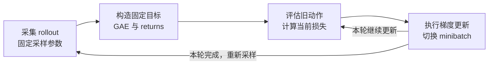

# PPO 算法完整解析与代码实现

## 1. 概述

PPO（Proximal Policy Optimization，近端策略优化）是一类同策略（On-Policy）策略优化算法。本文采用常见的 **PPO-Clip + 状态价值 Critic + GAE**：固定策略采集一批轨迹，计算优势与回报目标，再通过截断策略目标对同一批数据做有限次更新。PPO 允许使用其他优势估计方法；GAE 是本文选用的估计器。

理解 PPO，可以沿着一轮训练追踪三个问题：**哪些量来自环境，哪些量来自网络，哪些量在更新时保持固定？**



**本文主线**：Actor/Critic 的分工 → 固定 rollout → GAE 与 returns → 新旧策略比率 → PPO-Clip → 梯度更新 → 下一轮采样。主线结论与关键公式直接展示；证明、手算和实现变体放在就近的折叠块中。

先修知识为 [强化学习核心公式手册](../01_rl-foundations/01_reinforcement-learning-foundations.md) 中的价值函数、贝尔曼方程与策略梯度。本文给出理解 PPO 所需的 GAE 论述，可以独立读完一轮训练。算法依据 [PPO 原始论文](https://arxiv.org/abs/1707.06347)，工程对照使用 OpenAI Baselines PPO2，同时明确现代环境的终止与截断语义。

## 2. 基础与定义

### 2.1 Actor-Critic 与优势估计

状态价值 $V^\pi(s)$ 表示从状态 $s$ 出发、之后遵循策略 $\pi$ 时，折扣回报的期望。动作价值 $Q^\pi(s,a)$ 固定第一步动作，再遵循策略；优势定义为

$$
A^\pi(s,a)=Q^\pi(s,a)-V^\pi(s).
$$

优势衡量这个动作相对于当前策略平均表现的好坏。即时奖励为正，优势仍可能为负；Actor 学习的是动作相对表现，而非只看即时奖励的正负。

| 对象 | 输入与输出 | 可学习参数 | 在训练中的作用 |
| --- | --- | --- | --- |
| Actor $\pi_\theta$ | 状态 → 动作分布 | $\theta$ | 采样动作、计算 log probability 与熵 |
| Critic $V_\phi$ | 状态 → 标量价值 | $\phi$ | 为优势估计提供基线与 bootstrap |
| GAE 计算 | 奖励、旧价值、边界 → $\hat A_t$ | 无 | 构造 Actor 使用的优势估计 |
| Return target | $\hat A_t+V_{\rm old}(s_t)$ → $\hat R_t$ | 无 | 构造 Critic 的固定回归目标 |

本文实现只有 Actor 与 Critic 两个可学习功能，**不需要额外的 Advantage Network**。GAE 由采样数据计算，部署时 Actor 也不需要输入优势。直接学习 $A_\omega(s,a)$ 或 $Q_\omega(s,a)$ 属于另一个估计器设计，需要另行定义目标与一致性条件。

### 2.2 网络结构与优化器

| 架构 | 参数组织 | 损失对特征的影响 |
| --- | --- | --- |
| 独立 Actor / Critic | 各自的 MLP 与输出层，参数集合不相交 | 策略损失与价值损失分别更新自己的网络 |
| 共享 backbone + 双 head | $z=f_\psi(s)$，策略头 $\theta$，价值头 $\phi$ | 两种损失都更新共享特征参数 $\psi$ |

一个优化器可以同时管理两套独立参数；两个优化器也可以分别管理它们。**优化器的数量不决定参数是否共享。** 本文示例默认独立网络，`shared=True` 可切换为共享特征；两种结构都使用同一个总损失与一个 Adam。

“旧策略”表示本轮采样时的参数版本。常规前馈 PPO 只要保存采样动作的 `old_logprob`，通常就能计算后续概率比率，无须复制一套 Old Actor。若需要精确计算完整分布的 KL，则还要保存旧分布参数或旧模型。PPO2 的 `act_model` / `train_model` 是复用参数的采样与训练视图，不代表两个独立 Actor。

### 2.3 符号约定

本文沿用基础手册：执行 $a_t$ 后得到奖励 $r_{t+1}$ 和下一状态 $s_{t+1}$。代码的 `rewards[t]` 存的正是这个 $r_{t+1}$；所有边界标记也描述**执行动作 $a_t$ 之后**发生的事件。

| 符号 | 含义 |
| --- | --- |
| $\theta,\phi$；$\theta_{\rm old},\phi_{\rm old}$ | 当前 Actor/Critic 参数；本轮采样时的参数版本 |
| $\gamma,\lambda$ | 回报折扣因子；GAE 的多步加权参数 |
| $T,N,B=TN$ | 每个环境的 rollout 步数；并行环境数；总 transition 数 |
| $M,Q=B/M,K$ | minibatch 大小；每个 epoch 的 minibatch 数；更新 epoch 数 |
| $\ell_t^{\rm old},v_t^{\rm old}$ | 采样时保存的动作 logprob、状态价值 |
| $\hat A_t,\tilde A_t,\hat R_t$ | 原始 GAE；供 Actor 使用的标准化优势；Critic 的回报目标 |
| $\rho_t(\theta)$ | 新旧策略对同一状态、同一动作的概率或密度比；论文也记作 $r_t(\theta)$ |
| $\epsilon_\pi,\epsilon_v$ | 策略比率截断系数；可选价值截断范围 |
| $c_v,c_e$ | 价值损失系数；熵奖励系数 |

对单条轨迹省略环境下标；向量环境中所有时间递推分别在每个环境内进行。教学示例使用前馈网络与无界连续动作的对角高斯分布，输出联合 log probability；离散动作可换为 `Categorical` 分布。

### 2.4 采样与更新周期

**Episode** 是环境的一次完整回合。**Rollout** 是训练器本轮采集的数据段，一个 rollout 可以包含多个 episode，也可以在 episode 中途结束。**Epoch** 是优化器完整遍历本轮 rollout 一次。**Minibatch** 是一次参数更新使用的数据子集。

例如 $N=64,T=128$ 得到 $B=8192$ 条数据；若每个 epoch 分为 $Q=8$ 批，则 $M=1024$。重复 $K=4$ 个 epoch，共执行 $KQ=32$ 次 optimizer step。这 32 次更新使用同一批采样数据，但参数在每个 minibatch 后都会变化。

## 3. 核心原理

### 3.1 轨迹采样

一轮开始时冻结采样参数，使用

$$
a_t\sim\pi_{\theta_{\rm old}}(\cdot\mid s_t),
\qquad
\ell_t^{\rm old}=\log\pi_{\theta_{\rm old}}(a_t\mid s_t),
\qquad
v_t^{\rm old}=V_{\phi_{\rm old}}(s_t).
$$

每一步保存状态、实际采样动作、奖励、旧 logprob、旧价值以及 `terminated` / `truncated`。采样通常放在 `torch.no_grad()` 中，整个 rollout 结束前不更新网络。

计算优势还需要实际后继状态的旧价值 $v_{t+1}^{\rm next}$。普通连续转移可以复用下一步保存的旧价值；rollout 最后一步则需要额外计算 $V_{\rm old}(s_T)$。若环境在边界自动 reset，必须保留 **reset 前的真实末状态**，不能用下一 episode 的初始状态代替它。

| 数据 | 本轮多 epoch 更新期间 |
| --- | --- |
| 状态、采样动作、`old_logprobs`、`old_values` | 保持固定 |
| 原始 `advantages`、`returns` | 提前计算并固定，停止梯度 |
| 当前动作 logprob、当前 value、当前 entropy | 每个 minibatch 重新前向计算 |
| ratio、loss、梯度、网络参数 | 随当前参数变化 |

### 3.2 优势估计与价值目标

先区分两个边界问题：**这一条 transition 还能否从真实后继状态 bootstrap？优势递推还能否继续进入 buffer 的下一行？** 对每个环境分别定义

$$
b_t=1-\mathbb 1[\mathrm{terminated}_t],
\qquad
c_t=1-\mathbb 1[\mathrm{terminated}_t\lor\mathrm{truncated}_t].
$$

由此计算 TD residual、GAE 与回报目标：

$$
\boxed{\delta_t=r_{t+1}+\gamma b_t v_{t+1}^{\rm next}-v_t^{\rm old}}
$$

$$
\boxed{\hat A_t=\delta_t+\gamma\lambda c_t\hat A_{t+1},\qquad \hat A_T=0}
$$

$$
\boxed{\hat R_t=\hat A_t+v_t^{\rm old}}.
$$

其中 $\delta_t$ 是这一步结果相对旧价值预测的偏差；GAE 把后续 TD residual 折扣累积回来；$\hat R_t$ 把相对优势恢复为 Critic 可拟合的回报尺度。$\hat R_t$ 是带 bootstrap 的 $\lambda$-return 样本目标，通常不等于完整 episode 的 Monte Carlo return。

| 事件 | $b_t$：价值自举 | $c_t$：跨 buffer 行递推 | 处理方式 |
| --- | --- | --- | --- |
| 普通转移 | 1 | 1 | 继续累计同一 episode 的优势 |
| MDP 真正终止 | 0 | 0 | 不使用后继价值，切断递推 |
| 外部 TimeLimit 截断并 reset | 1 | 0 | 从真实末状态自举，切断与新 episode 的递推 |
| 仅达到 rollout 长度，episode 仍继续 | 1 | 1 | $\hat A_T=0$ 结束本段累积，末状态价值仍保留 |

这里的 `truncated` 表示 MDP 外部的采样限制；如果有限时域本身就是任务定义的一部分，时间耗尽属于终止，还需要让观测包含剩余时间。该区别遵循 [Gymnasium 的时间限制说明](https://gymnasium.farama.org/tutorials/gymnasium_basics/handling_time_limits/)。旧版 PPO2 的统一 `done` 逻辑需要结合其历史环境约定理解。

Actor 可以标准化优势，**Critic target 必须先用未标准化的优势构造**。$\gamma$ 改变价值函数预测的折扣回报；$\lambda$ 改变如何用同一组 TD residual 估计优势：$\lambda=0$ 只使用一步 TD，$\lambda=1$ 使用当前段内全部折扣 residual，末端仍可能包含 bootstrap。

<details class="kt-derivation" id="ppo-td-advantage">
<summary>TD 残差与优势估计</summary>

从优势定义与动作价值的贝尔曼展开开始：

$$
\begin{aligned}
A^{\pi_{\rm old}}(s_t,a_t)
&=Q^{\pi_{\rm old}}(s_t,a_t)-V^{\pi_{\rm old}}(s_t),\\
Q^{\pi_{\rm old}}(s_t,a_t)
&=\mathbb E\!\left[
r_{t+1}+\gamma b_tV^{\pi_{\rm old}}(s_{t+1}^{\star})
\mid s_t,a_t\right].
\end{aligned}
$$

$s_{t+1}^{\star}$ 表示实际转移到的状态，即 reset 前的后继状态。代回后得到

$$
A^{\pi_{\rm old}}(s_t,a_t)
=\mathbb E\!\left[
r_{t+1}+\gamma b_tV^{\pi_{\rm old}}(s_{t+1}^{\star})
-V^{\pi_{\rm old}}(s_t)\mid s_t,a_t\right].
$$

用旧 Critic 近似真实价值函数，括号内就是 TD residual $\delta_t$。当 Critic 完全准确时，$\mathbb E[\delta_t\mid s_t,a_t]=A^{\pi_{\rm old}}(s_t,a_t)$；单次 residual 仍有采样噪声。Critic 不准确时，还会引入估计偏差。

例如 $V(s_t)=5,r_{t+1}=2,V(s_{t+1})=6,\gamma=0.9$ 且未终止，则 $\delta_t=2+0.9\times6-5=2.4$。这表明本次一步 target 比原预测高 2.4，并不保证该动作真实优势精确等于 2.4。

</details>

<details class="kt-derivation" id="ppo-gae-derivation">
<summary>GAE 与有限时域 λ-return</summary>

先考虑同一 episode 内的连续片段，简记旧价值为 $V$。一步、二步和三步优势估计分别为

$$
\hat A_t^{(1)}=\delta_t,\qquad
\hat A_t^{(2)}=\delta_t+\gamma\delta_{t+1},\qquad
\hat A_t^{(3)}=\delta_t+\gamma\delta_{t+1}+\gamma^2\delta_{t+2}.
$$

二步展开显示了中间价值项的抵消：

$$
\begin{aligned}
\delta_t+\gamma\delta_{t+1}
&=r_{t+1}+\gamma V(s_{t+1})-V(s_t)\\
&\quad+\gamma[r_{t+2}+\gamma V(s_{t+2})-V(s_{t+1})]\\
&=r_{t+1}+\gamma r_{t+2}+\gamma^2V(s_{t+2})-V(s_t).
\end{aligned}
$$

一般地，$n$ 步 residual 之和等于 $n$ 步 bootstrap 回报减去当前基线：

$$
\hat A_t^{(n)}
=\sum_{l=0}^{n-1}\gamma^l\delta_{t+l}
=\underbrace{\sum_{l=0}^{n-1}\gamma^lr_{t+l+1}+\gamma^nV(s_{t+n})}_{\hat R_t^{(n)}}-V(s_t).
$$

在无限连续轨迹上，$0\leq\lambda<1$ 时以几何权重组合不同步数的估计：

$$
\begin{aligned}
\hat A_t^{\rm GAE}
&=(1-\lambda)\sum_{n=1}^{\infty}\lambda^{n-1}\hat A_t^{(n)}\\
&=\sum_{l=0}^{\infty}(\gamma\lambda)^l\delta_{t+l}.
\end{aligned}
$$

有限 rollout 中，令 $H$ 为从当前时间起到下一个 episode 边界或 rollout 末端的可用步数。正确的有限混合式将最后的剩余权重留给最长回报：

$$
\boxed{
\hat A_t^{\rm GAE}
=(1-\lambda)\sum_{n=1}^{H-1}\lambda^{n-1}\hat A_t^{(n)}
+\lambda^{H-1}\hat A_t^{(H)}
=\sum_{l=0}^{H-1}(\gamma\lambda)^l\delta_{t+l}
}.
$$

最长回报在真实终止处使用零末值，在外部截断或 rollout 末端使用旧 Critic 的末值。权重总和为 1，所以把同一个基线加回去就得到

$$
\boxed{
\hat R_t^{(\lambda)}
=(1-\lambda)\sum_{n=1}^{H-1}\lambda^{n-1}\hat R_t^{(n)}
+\lambda^{H-1}\hat R_t^{(H)}
=\hat A_t^{\rm GAE}+V(s_t)
}.
$$

这说明 `returns = advantages + old_values` 恢复的是同一组多步回报的加权目标。对于旧策略采样的动作与转移取平均，且 bootstrap 价值准确时，它对应旧策略状态价值；实际 target 仍包含采样噪声和 Critic 的 bootstrap 误差。

将 residual 求和式的首项提出，即得反向递推。在包含多个 episode 的 buffer 中用 $c_t$ 截断递推链，可统一写成

$$
\hat A_t
=\sum_{l=0}^{T-t-1}(\gamma\lambda)^l
\left(\prod_{j=0}^{l-1}c_{t+j}\right)\delta_{t+l}
=\delta_t+\gamma\lambda c_t\hat A_{t+1}.
$$

空乘积取 1。倒序循环直接以 $O(TN)$ 次标量运算计算所有优势；它是高效实现方式，数学上也可使用求和或并行 scan。

在连续片段内部，return 还满足

$$
\hat R_t
=r_{t+1}+\gamma\left[(1-\lambda)V(s_{t+1})+\lambda\hat R_{t+1}\right].
$$

这个式子不跨越 reset 边界。$\lambda=0$ 得到一步 TD target；$\lambda=1$ 得到

$$
\hat R_t=\sum_{l=0}^{H-1}\gamma^lr_{t+l+1}+\gamma^H V_{\rm boot}(s_{t+H}).
$$

只有片段延伸到真实 episode 终点且末值为零时，$\lambda=1$ 的 target 才是完整采样折扣回报。上述推导承接 [GAE 原始论文](https://arxiv.org/abs/1506.02438)。

</details>

<details class="kt-derivation" id="ppo-gae-worked-example">
<summary>GAE 数值算例</summary>

设 $\gamma=0.9,\lambda=0.8$，整个片段没有终止或 reset；奖励为 $[1,0,2,1]$，旧价值为 $[2,2.5,2,1.5]$，额外计算末状态价值 $V(s_4)=1$。

$$
\boldsymbol\delta=[1.25,-0.7,1.35,0.4],\qquad \gamma\lambda=0.72.
$$

从 $\hat A_4=0$ 开始反向计算：

$$
\begin{aligned}
\hat A_3&=0.4,\\
\hat A_2&=1.35+0.72\times0.4=1.638,\\
\hat A_1&=-0.7+0.72\times1.638=0.47936,\\
\hat A_0&=1.25+0.72\times0.47936=1.5951392.
\end{aligned}
$$

| $t$ | $r_{t+1}$ | $v_t^{\rm old}$ | $\delta_t$ | $\hat A_t$ | $\hat R_t=\hat A_t+v_t^{\rm old}$ |
| --- | --- | --- | --- | --- | --- |
| 0 | 1 | 2.0 | 1.25 | 1.5951392 | 3.5951392 |
| 1 | 0 | 2.5 | −0.70 | 0.47936 | 2.97936 |
| 2 | 2 | 2.0 | 1.35 | 1.638 | 3.638 |
| 3 | 1 | 1.5 | 0.40 | 0.4 | 1.9 |

第 1 步的 TD residual 为负，但后续 residual 使 GAE 变为正；单步反馈与多步优势估计可能不同。

如果只把 $\lambda$ 改为 1，则

$$
\hat R_0=1+0.9\times0+0.9^2\times2+0.9^3\times1+0.9^4\times1=4.0051.
$$

最后一项来自末状态 bootstrap。$\hat A_4=0$ 仅表示不继续累积 rollout 外部 residual，并不要求 $V(s_4)=0$。

再看截断：若当前奖励为 1，旧状态价值为 0，真实末状态价值为 10，$\gamma=0.9$，则外部截断处的优势为 $1+0.9\times10=10$。即使下一行新 episode 的奖励为 1000，它也不能通过 GAE 递推传播回来；真实终止时同一条 transition 的优势则为 1。

</details>

### 3.3 策略梯度与概率比率

优势形式的策略梯度把“提高或降低哪个动作概率”与优势联系起来：

$$
\nabla_\theta J(\theta)
\propto\mathbb E_{s_t,a_t\sim\pi_\theta}
\left[\nabla_\theta\log\pi_\theta(a_t\mid s_t)A^{\pi_\theta}(s_t,a_t)\right].
$$

PPO 更新时，数据仍来自采样时的旧策略。对 buffer 中的**同一个状态和已采样动作**，用当前 Actor 重新计算 log probability，并定义

$$
\boxed{
\rho_t(\theta)
=\frac{\pi_\theta(a_t\mid s_t)}{\pi_{\theta_{\rm old}}(a_t\mid s_t)}
=\exp\left(\ell_t^{\rm new}-\ell_t^{\rm old}\right)
}.
$$

例如旧策略对动作 1 的概率为 0.5，当前策略为 0.65，则 $\rho_t=1.3$。**更新时重新评估旧动作，不重新采样动作替换它。** 连续动作中的 $\pi(a\mid s)$ 是密度，联合 logprob 要沿动作维求和。

由此构造局部替代目标

$$
L^{\rm CPI}(\theta)=\hat{\mathbb E}_t[\rho_t(\theta)\hat A_t].
$$

在 $\theta=\theta_{\rm old}$ 时 ratio 为 1，其梯度与同批优势策略梯度一致。比率校正的是固定状态下的动作分布；rollout 状态仍来自旧策略，所以它没有精确校正整个新策略轨迹分布。多轮更新必须控制策略漂移。

<details class="kt-derivation" id="ppo-importance-sampling">
<summary>重要性采样与替代目标</summary>

给定同一个状态 $s$，若新策略需要的动作均在旧策略的支撑集内，则对可积函数 $f$：

$$
\mathbb E_{a\sim\pi_{\rm old}(\cdot\mid s)}
\left[\frac{\pi_\theta(a\mid s)}{\pi_{\rm old}(a\mid s)}f(a)\right]
=\mathbb E_{a\sim\pi_\theta(\cdot\mid s)}[f(a)].
$$

离散动作下，直接按期望定义展开：

$$
\begin{aligned}
\sum_a\pi_{\rm old}(a\mid s)
\frac{\pi_\theta(a\mid s)}{\pi_{\rm old}(a\mid s)}f(a)
&=\sum_a\pi_\theta(a\mid s)f(a).
\end{aligned}
$$

连续动作下把求和换成积分：

$$
\int\pi_{\rm old}(a\mid s)
\frac{\pi_\theta(a\mid s)}{\pi_{\rm old}(a\mid s)}f(a)\,\mathrm da
=\int\pi_\theta(a\mid s)f(a)\,\mathrm da.
$$

旧策略概率或密度在乘积中约掉，这个结论仅针对动作分布。PPO 中仍对旧策略采样的状态求平均，且 $\hat A_t$ 是旧策略优势的样本估计，因此称为替代目标，而非新策略完整回报的精确表达式。

基础经验策略梯度目标为

$$
L^{\rm PG}(\theta)=\hat{\mathbb E}_t[\log\pi_\theta(a_t\mid s_t)\hat A_t].
$$

由于 $\nabla_\theta\rho_t=\rho_t\nabla_\theta\log\pi_\theta$，且本轮固定 $\hat A_t$，有

$$
\left.\nabla_\theta L^{\rm CPI}\right|_{\theta_{\rm old}}
=\hat{\mathbb E}_t[\nabla_\theta\log\pi_{\theta_{\rm old}}(a_t\mid s_t)\hat A_t]
=\left.\nabla_\theta L^{\rm PG}\right|_{\theta_{\rm old}}.
$$

这解释了替代目标在旧策略处的一阶一致性。更新离旧策略越远，状态分布与优势估计的局部近似越需要谨慎；比率本身不提供任意跨策略版本复用数据的保证。

</details>

### 3.4 截断策略目标

[TRPO](./03_trpo.md) 通过平均 KL 约束限制新旧策略距离，通常需要二阶近似、共轭梯度与线搜索。PPO-Clip 采用可直接用一阶优化器训练的目标：

$$
\boxed{
L^{\rm CLIP}(\theta)
=\hat{\mathbb E}_t\left[
\min\left(
\rho_t(\theta)\hat A_t,
\operatorname{clip}(\rho_t(\theta),1-\epsilon_\pi,1+\epsilon_\pi)\hat A_t
\right)\right]
}.
$$

当 $\hat A_t>0$，提高动作概率有利，但 ratio 超过 $1+\epsilon_\pi$ 后，这条样本的策略目标不再奖励继续增加；当 $\hat A_t<0$，降低动作概率有利，但 ratio 低于 $1-\epsilon_\pi$ 后不再奖励继续降低。朝不利方向的偏移仍会产生纠正梯度。

**Clip 限制的是单样本目标的优化激励，并不把 ratio 硬性限制在区间内，也不规定参数最多变化多少。** 其他样本、共享特征和熵项仍可能改变同一状态的策略。PPO-Clip 不保证严格的 KL 信赖域，工程实现可额外监控 KL 并提前停止本轮更新。

优化器采用梯度下降，因此策略损失取反：$L_\pi=-L^{\rm CLIP}$。若使用标准化优势，公式中的 $\hat A_t$ 换为 $\tilde A_t$。

<details class="kt-derivation" id="ppo-clip-cases">
<summary>截断目标的分段形式</summary>

单条样本的最大化目标可化简为

$$
L_t^{\rm CLIP}
=\begin{cases}
\hat A_t\min(\rho_t,1+\epsilon_\pi), & \hat A_t\geq0,\\
\hat A_t\max(\rho_t,1-\epsilon_\pi), & \hat A_t<0.
\end{cases}
$$

取 $\epsilon_\pi=0.2$：

| 优势 | ratio | 未截断项 | 截断项 | 取 min 后的目标 | 此样本是否进入平坦区 |
| --- | --- | --- | --- | --- | --- |
| $+2$ | 1.3 | 2.6 | 2.4 | 2.4 | 是：好动作继续增加的激励消失 |
| $-2$ | 0.7 | −1.4 | −1.6 | −1.6 | 是：差动作继续减少的激励消失 |
| $+2$ | 0.7 | 1.4 | 1.6 | 1.4 | 否：好动作概率降低，保留纠正梯度 |
| $-2$ | 1.3 | −2.6 | −2.4 | −2.6 | 否：差动作概率提高，保留纠正梯度 |

这里是最大化目标；代码中的 loss 为其负值。所以 `-minimum(unclipped, clipped)` 与对两项取负后再 `maximum` 等价。`clipfrac` 通常只统计 ratio 在区间外的比例，上表四条都计入，实际进入平坦区的只有两条。

</details>

<details class="kt-derivation" id="ppo-kl-estimation">
<summary>KL 散度与采样估计</summary>

对固定状态，从旧策略到新策略的 KL 为

$$
D_{\rm KL}(\pi_{\rm old}(\cdot\mid s)\|\pi_\theta(\cdot\mid s))
=\mathbb E_{a\sim\pi_{\rm old}}
\left[\log\pi_{\rm old}(a\mid s)-\log\pi_\theta(a\mid s)\right].
$$

离散动作时显式求和，连续动作时积分。KL 非负且不对称。再对旧策略的状态访问分布 $d_{\rm old}$ 取平均，得到 TRPO 使用的约束量：

$$
\begin{aligned}
\bar D_{\rm KL}(\theta_{\rm old},\theta)
&=\mathbb E_{s\sim d_{\rm old}}[D_{\rm KL}(\pi_{\rm old}(\cdot\mid s)\|\pi_\theta(\cdot\mid s))]\\
&=\mathbb E_{\substack{s\sim d_{\rm old}\\a\sim\pi_{\rm old}(\cdot\mid s)}}
[\ell^{\rm old}-\ell^{\rm new}].
\end{aligned}
$$

对应优化问题为

$$
\max_\theta\ \hat{\mathbb E}_t[\rho_t\hat A_t]
\quad\text{s.t.}\quad\bar D_{\rm KL}(\theta_{\rm old},\theta)\leq\delta_{\rm KL}.
$$

如果保存了旧分布参数，可计算每个采样状态上的完整 KL，再取算术平均：

$$
\widehat{\bar D}_{\rm KL}
=\frac1B\sum_{t=1}^{B}D_{\rm KL}(\pi_{\rm old}(\cdot\mid s_t)\|\pi_\theta(\cdot\mid s_t)).
$$

如果仅保存每个状态实际采到的动作及其 logprob，则常见诊断量有：

| 名称 | 样本表达式 | 解释 |
| --- | --- | --- |
| 对数比率估计 | $-\operatorname{mean}(\log\rho)$ | 期望为旧到新 KL，有限样本均值可能为负 |
| 非负比率估计 | $\operatorname{mean}(\rho-1-\log\rho)$ | 本文代码采用；同一精确期望，有限样本结果不同 |
| PPO2 二次近似 | $\frac12\operatorname{mean}[(\log\rho)^2]$ | 小变化下的近似诊断，不是精确 KL |

因为对 $x>0$ 有 $x-1-\log x\geq0$，第二种估计的单样本项非负；在相互兼容的支撑集条件下，$\mathbb E_{a\sim\pi_{\rm old}}[\rho]=1$，故其精确期望仍等于 $-\mathbb E[\log\rho]$。有限浮点运算可能有极小舍入误差。

本文代码使用非负比率估计，历史 [PPO2 model.py](https://github.com/openai/baselines/blob/ea25b9e8b234e6ee1bca43083f8f3cf974143998/baselines/ppo2/model.py) 使用二次近似；比较不同实现日志前要先核对公式和 KL 方向。

</details>

<details class="kt-derivation" id="ppo-gaussian-kl">
<summary>高斯策略的 KL 散度</summary>

先考虑一维旧策略 $\mathcal N(\mu_0,\sigma_0^2)$ 与新策略 $\mathcal N(\mu_1,\sigma_1^2)$。由高斯 log density 展开：

$$
\begin{aligned}
D_{\rm KL}(\pi_{\rm old}\|\pi_{\rm new})
&=\mathbb E_{a\sim\mathcal N(\mu_0,\sigma_0^2)}
\left[\log\frac{\sigma_1}{\sigma_0}
+\frac{(a-\mu_1)^2}{2\sigma_1^2}
-\frac{(a-\mu_0)^2}{2\sigma_0^2}\right].
\end{aligned}
$$

旧分布下有

$$
\mathbb E[(a-\mu_0)^2]=\sigma_0^2,
\qquad
\mathbb E[(a-\mu_1)^2]=\sigma_0^2+(\mu_0-\mu_1)^2.
$$

代入得到

$$
\boxed{
D_{\rm KL}(\pi_{\rm old}\|\pi_{\rm new})
=\log\frac{\sigma_1}{\sigma_0}
+\frac{\sigma_0^2+(\mu_0-\mu_1)^2}{2\sigma_1^2}-\frac12
}.
$$

对 $D$ 个独立动作维度，联合 KL 等于各维 KL 之和；再对 $B$ 个 rollout 状态取平均：

$$
\boxed{
\widehat{\bar D}_{\rm KL}
=\frac1B\sum_{t=1}^{B}\sum_{j=1}^{D}
\left[\log\frac{\sigma_{1,j}(s_t)}{\sigma_{0,j}(s_t)}
+\frac{\sigma_{0,j}^2(s_t)+(\mu_{0,j}(s_t)-\mu_{1,j}(s_t))^2}{2\sigma_{1,j}^2(s_t)}-\frac12\right]
}.
$$

若新旧标准差相同，单个状态上的 KL 进一步化为

$$
D_{\rm KL}=\frac12\sum_{j=1}^{D}
\frac{(\mu_{0,j}(s)-\mu_{1,j}(s))^2}{\sigma_j^2}.
$$

该闭式计算需要旧、新两组均值和标准差。本文最小示例只保存旧动作 logprob，因此记录采样近似 KL，不把它当作完整高斯 KL。

</details>

### 3.5 联合损失与梯度更新

Critic 对固定 return target 做回归：

$$
L_V(\phi)=\frac12\hat{\mathbb E}_t[(V_\phi(s_t)-\hat R_t)^2].
$$

当前策略熵为 $\mathcal H_t=-\mathbb E_{a\sim\pi_\theta(\cdot\mid s_t)}[\log\pi_\theta(a\mid s_t)]$。离散动作对应普通熵，连续动作对应微分熵；在同一动作坐标与分布族内，熵奖励鼓励保持探索。总的最小化损失为

$$
\boxed{L_{\rm total}=L_\pi+c_vL_V-c_e\hat{\mathbb E}_t[\mathcal H_t]}.
$$

等价的最大化写法是 $L^{\rm CLIP}-c_vL_V+c_e\hat{\mathbb E}_t[\mathcal H_t]$。可选价值截断会替换 $L_V$，不改变策略 Clip 的定义。

虽然优势来自 Critic，**本轮 Actor loss 不沿 GAE 反向传播到旧 Critic**：优势、旧值、旧 logprob 和 return target 都是常量。独立网络时，策略损失与熵项更新 Actor，价值损失更新 Critic；共享特征时，两路梯度共同更新 backbone。

<details class="kt-derivation" id="ppo-gradient-flow">
<summary>独立网络与共享特征的梯度</summary>

独立参数下：

$$
\nabla_\theta L_{\rm total}=\nabla_\theta L_\pi-c_e\nabla_\theta\hat{\mathbb E}[\mathcal H],
\qquad
\nabla_\phi L_{\rm total}=c_v\nabla_\phi L_V.
$$

在本轮更新计算图中，$\partial\hat A_t/\partial\phi=0$，$\partial\hat R_t/\partial\phi=0$；这是提前在 `no_grad()` 中计算、存储并 `detach()` 的结果。若错误地每次使用 `returns = advantages + new_values` 且让 target 参与梯度，训练目标和梯度就会改变。

共享架构写作 $z=f_\psi(s)$，$\pi_\theta(a\mid z)$，$V_\phi(z)$。共享参数接收

$$
\nabla_\psi L_{\rm total}
=\nabla_\psi L_\pi+c_v\nabla_\psi L_V-c_e\nabla_\psi\hat{\mathbb E}[\mathcal H].
$$

价值目标也可能通过 backbone 改变策略特征；这与“优势 target 停止梯度”是两个不同路径。

一次 optimizer step 的顺序是：

```python
optimizer.zero_grad(set_to_none=True)
terms.total.backward()
nn.utils.clip_grad_norm_(model.parameters(), max_grad_norm)
optimizer.step()
```

`backward()` 计算并保存梯度，参数到 `step()` 才更新。全局梯度范数裁剪可写成

$$
g=\nabla L_{\rm total},\qquad
g\leftarrow g\min\left(1,\frac{g_{\max}}{\lVert g\rVert_2}\right),
$$

实现会处理零范数的数值情况。联合裁剪时，Actor 与 Critic 共用缩放系数，即使两套网络不共享参数，也会在有效梯度大小上发生耦合；分别裁剪是另一个实现选择。Adam 随后利用梯度及其一阶、二阶动量更新参数。

</details>

<details class="kt-derivation" id="ppo-value-clipping">
<summary>价值截断</summary>

以旧价值为中心限制当前预测的变化：

$$
V_t^{\rm clip}=v_t^{\rm old}
+\operatorname{clip}(V_\phi(s_t)-v_t^{\rm old},-\epsilon_v,\epsilon_v).
$$

然后使用普通误差与截断误差的较大者：

$$
L_V^{\rm clip}
=\frac12\hat{\mathbb E}_t
\left[\max\left((V_\phi(s_t)-\hat R_t)^2,(V_t^{\rm clip}-\hat R_t)^2\right)\right].
$$

这会抑制部分过大的价值变化所能带来的 loss 改善，仍不保证当前预测硬性落在区间内。它是实现变体，并非 PPO 策略截断的必要部分。

$\epsilon_\pi$ 限制无量纲的概率比率，$\epsilon_v$ 使用价值的回报单位。历史 PPO2 复用了同一个数值，其他实现允许独立配置或关闭。本文示例默认普通 MSE；设置 `value_clip=0.2` 可启用该变体。奖励缩放改变后应重新理解其尺度。

</details>

### 3.6 多轮小批量更新

先在 `[T,N]` 上完成 GAE，再把所有字段按同样顺序展平为 `[B,...]`。对前馈策略，每个 epoch 打乱 $B$ 个 transition 索引，依次取 minibatch；每批当前网络重新计算 logprob、value 和 entropy。

若使用 minibatch 优势标准化，定义

$$
\tilde A_t=\frac{\hat A_t-\bar A_{\mathcal M}}{\sigma_{\mathcal M}+\eta},
\quad
\bar A_{\mathcal M}=\frac1M\sum_{t\in\mathcal M}\hat A_t,
\quad
\sigma_{\mathcal M}^2=\frac1M\sum_{t\in\mathcal M}(\hat A_t-\bar A_{\mathcal M})^2.
$$

`returns` 保持原始尺度。也有实现对整个 rollout 统一标准化；两者都是工程选择，不能假定训练结果完全相同。本文采用 minibatch 标准化，并以总体标准差 `std(correction=0)` 对应上式。

每个 minibatch 执行前向、计算 loss、清梯度、反向、梯度裁剪、Adam step。完成 $K$ 个 epoch 后丢弃本轮 buffer，用最新策略重新采样。有限复用这批数据仍属于常见的 on-policy PPO 流程；它不把历史数据长期保存在跨多个策略版本的 replay buffer 中。

循环网络需要保存序列结构与隐藏状态，不能把各时间步随意打散。本页的展平随机采样规则针对前馈 PPO。

## 4. 实现与应用

### 4.1 张量结构

| 字段 | 采样 / GAE 阶段 | 更新阶段 | 对应数学量 |
| --- | --- | --- | --- |
| `obs` | `[T,N,obs_dim]` | `[B,obs_dim]` | $s_t$ |
| `actions` | `[T,N,action_dim]` | `[B,action_dim]` | 已采样 $a_t$ |
| `old_logprobs` | `[T,N]` | `[B]` | $\ell_t^{\rm old}$ |
| `old_values` | `[T,N]` | `[B]` | $v_t^{\rm old}$ |
| `rewards`、`next_values` | `[T,N]` | 用于预先计算 target | $r_{t+1},v_{t+1}^{\rm next}$ |
| `terminated`、`truncated` | `[T,N]`，布尔类型 | 用于预先计算 target | 动作之后的边界 |
| `advantages`、`returns` | `[T,N]` | `[B]` | $\hat A_t,\hat R_t$ |

采样与训练的网络输入都保留 batch 维，即使只有一个环境也使用 `[1,obs_dim]`。连续策略使用 `Independent(Normal(mean, std), 1)`，使联合 logprob 和 entropy 的形状均为 `[B]`；价值输出使用 `squeeze(-1)` 得到 `[B]`，避免意外广播成 `[B,B]`。

| 数学步骤 | 完整示例中的实现 |
| --- | --- |
| Actor / Critic 与可选共享特征 | `ActorCritic`，`distribution()`、`value()` |
| 固定旧策略采样 | `sample()` 与 `synthetic_rollout()` 中的 `no_grad()` |
| 两种边界 mask、TD、GAE、returns | `compute_gae()` |
| 全字段保持相同展平顺序并停止梯度 | `flatten_rollout()` 与 `PPOBatch` |
| 当前参数重新评估旧动作 | `evaluate(obs, actions)` |
| ratio、策略损失、价值损失、熵 | `ppo_loss()` |
| 多 epoch、minibatch、全局梯度裁剪 | `ppo_update()` |

### 4.2 目标计算与参数更新

GAE 先沿时间倒序计算，每个环境保留独立的 `last_gae`：

```python
bootstrap_mask = (~terminated).to(rewards.dtype)
trace_mask = (~(terminated | truncated)).to(rewards.dtype)
advantages = torch.zeros_like(rewards)
last_gae = torch.zeros_like(rewards[0])  # [N]
for t in reversed(range(rewards.shape[0])):
    delta = rewards[t] + gamma * bootstrap_mask[t] * next_values[t] - values[t]
    last_gae = delta + gamma * gae_lambda * trace_mask[t] * last_gae
    advantages[t] = last_gae
returns = advantages + values
```

这段逻辑在示例的 `@torch.no_grad()` 函数中执行。更新阶段的主要损失对应为：

```python
new_logprobs, entropy, new_values = model.evaluate(batch.obs, batch.actions)
logratio = new_logprobs - batch.old_logprobs
ratio = logratio.exp()
advantages = batch.advantages
advantages = (advantages - advantages.mean()) / (advantages.std(correction=0) + 1e-8)
unclipped = ratio * advantages
clipped = ratio.clamp(1 - policy_clip, 1 + policy_clip) * advantages
policy_loss = -torch.minimum(unclipped, clipped).mean()
value_loss = 0.5 * (new_values - batch.returns).square().mean()
total = policy_loss + value_coef * value_loss - entropy_coef * entropy.mean()
```

以上是完整示例默认的普通 MSE 路径。参数更新只改变 `model` 与优化器状态；`batch` 中的旧 logprob、旧价值、原始优势和 returns 都保持不变。

<details class="kt-derivation" id="ppo-update-code">
<summary>小批量更新流程</summary>

下面省略指标累计，保留与 `ppo_update()` 相同的核心调用次序；`batch.select()` 会保持所有字段的索引一致。

```python
for _ in range(epochs):
    indices = torch.randperm(batch.obs.shape[0], device=batch.obs.device)
    for start in range(0, batch.obs.shape[0], minibatch_size):
        minibatch = batch.select(indices[start:start + minibatch_size])
        terms = ppo_loss(model, minibatch, policy_clip=policy_clip,
                         value_clip=value_clip, value_coef=value_coef,
                         entropy_coef=entropy_coef)
        optimizer.zero_grad(set_to_none=True)
        terms.total.backward()
        nn.utils.clip_grad_norm_(
            model.parameters(), max_grad_norm, error_if_nonfinite=True,
        )
        optimizer.step()
```

完整函数还校验 $B$ 可被 minibatch 大小整除、loss 有限，并累计每次更新前的诊断量。第一个 optimizer step 之前 ratio 应接近 1；第二个 minibatch 开始时参数已经更新，不能继续要求 ratio 等于 1。

独立 Actor / Critic 共用一个 Adam 的初始化如下，优化器管理全部参数，但网络参数仍各自独立：

```python
model = ActorCritic(obs_dim=4, action_dim=2)
optimizer = torch.optim.Adam(model.parameters(), lr=3e-4, eps=1e-5)
```

示例使用两层 64 单元 Tanh MLP、正交初始化、独立可学习 `log_std`。这些超参数是教学配置，不是 PPO 的必要定义。

</details>

### 4.3 完整示例

完整实现维护于仓库 `examples/ppo_core.py`，可直接 [下载 PPO 教学示例](/knowledge-tree/examples/ppo_core.py)。它包含 `ActorCritic`、GAE、数据展平、损失、多轮更新和合成 rollout；正文仅保留关键片段。

在已安装 PyTorch 的 Python 环境中，从仓库根目录运行：

```bash
python examples/ppo_core.py
python -m unittest discover -s tests -p 'test_ppo_core.py' -v
```

下载单个文件后也可以直接执行 `python ppo_core.py`。示例不依赖 Gym 或 GPU，已在 Python 3.8、PyTorch 2.4.1 的 CPU 环境验证。默认采集 $T=16,N=4$，得到 64 条数据，再做 4 个 epoch、每批 16 条，共 16 次参数更新。

输出 JSON 中 `batch_size` 为 64、`optimizer_steps` 为 16；`initial_ratio_max_error` 应接近 0，loss 与梯度等数值应有限。该合成例子用于检验数据与梯度闭环，不表示任何真实控制任务的训练成绩。

### 4.4 环境接口

真实采集器替换 `synthetic_rollout()`，继续提供 `[T,N,...]` 的数据。每次环境 step 后先取得真实后继观测与边界标记，再记录 `next_values`；若 wrapper 自动 reset，按对应版本的接口取出 final observation。把 reset 后的初始状态送入下一次 Actor，不能拿它替代上一条截断 transition 的末状态。

本文策略是无界高斯。接入有界动作空间时，需要明确动作变换与 logprob 的对应关系，例如使用带 Jacobian 修正的 squashed Gaussian，或明确保留原始采样动作并采用相应裁剪执行约定；不能把裁剪后的动作直接当成原始高斯样本而混算概率。

回归测试覆盖手算 GAE、$\lambda=0/1$、有限混合尾项、真实终止与截断的差别、并行链隔离、张量形状、联合 logprob、独立与共享梯度路径，以及参数更新期间 buffer 不变。它们验证公式与实现边界，训练效果仍需在目标环境中评估。

## 5. 分析与总结

### 5.1 算法机制与实现变体

| 层次 | 本文采用的机制 | 适用边界 |
| --- | --- | --- |
| PPO-Clip 核心 | 新旧策略比率、保守的截断替代目标 | 允许有限复用本轮数据，不保证严格 KL 约束 |
| 优势与价值估计 | V-Critic、GAE、$\lambda$-return | 受采样噪声与 bootstrap 误差影响 |
| 网络组织 | 独立网络，支持共享 backbone | 共享参数会同时接收策略与价值梯度 |
| 训练配置 | Adam、优势标准化、全局梯度裁剪 | 改变优化行为，应记录具体配置 |
| 可选稳定措施 | 熵奖励、价值截断、KL early stopping | 各实现选择不同；本示例提供前两项配置，KL 记录为诊断 |

PPO 的实现相对直接，可用于离散和连续动作，但需要持续的新交互数据。增大 epoch 数并不等于无限提高样本效率：旧数据上的过度拟合、策略漂移和不准确的优势估计都会影响更新质量。

### 5.2 训练诊断指标

| 指标 | 应怎样解读 | 优先检查 |
| --- | --- | --- |
| 首次更新前 ratio | 同参数、同观测预处理、同动作时应接近 1 | 模型版本、动作变换、logprob 维度、随机层 |
| `policy_loss` | 当前 batch 的替代目标，不能单独代表任务表现 | 联看回报、KL、clipfrac 与优势分布 |
| `value_loss` | 当前价值对固定 return target 的误差 | 奖励尺度、边界处理、target 是否停止梯度 |
| `entropy` | 当前动作分布随机性 | 标准差、动作坐标与熵系数；连续熵允许为负 |
| `approx_kl` | 本轮策略漂移的采样诊断 | 先核对具体公式，再查学习率、epoch 数 |
| `clipfrac` | ratio 超出区间的样本比例 | 不等于实际进入 Clip 平坦区的比例 |
| `grad_norm_before_clip` | 全部参数裁剪前的梯度范数 | 与阈值比较，并留意两路损失的梯度规模 |
| `explained_variance` | $1-\operatorname{Var}(\hat R-V)/\operatorname{Var}(\hat R)$ | 区分新/旧价值；target 方差为零时无定义 |

本示例记录 loss、entropy、近似 KL、clipfrac 与裁剪前梯度范数等训练量，并在更新前单独检查 ratio。各 minibatch 指标是 step 前观测的均值，不应误读为整轮更新完成后的完整分布测量。

一个常见误解是“policy loss 接近 0 就没有学习”。标准化优势在初始 ratio=1 时均值为 0，所以 $L_\pi=-\operatorname{mean}(\tilde A)\approx0$；但 $-\operatorname{mean}(\tilde A\nabla\log\pi)$ 仍可非零。应观察梯度、策略变化与任务指标。

### 5.3 常见实现错误

- 把 GAE 优势当成需要另训的网络输出，或让 Actor loss 沿 target 反向传播到 Critic。
- 更新时重新采样动作，导致新旧 logprob 对应不同动作。
- 标准化优势后再构造 returns，破坏 Critic target 的回报尺度。
- 用一个 `done` 同时决定所有 bootstrap 与跨 episode 递推，或在截断后使用 reset 观测的价值。
- 在 GAE 之前将不同环境的时间线展平混在一起，或打乱循环策略的序列。
- 将概率比率剪裁、价值剪裁和梯度范数裁剪混为一个机制。

### 5.4 核心结论

PPO 的学习对象是策略与价值函数；GAE 从固定 rollout 构造训练信号。更新阶段重新计算当前网络对旧数据的输出，保持旧 logprob、旧价值、原始优势和 return target 固定。Clip 抑制部分过大的有利更新，通过多个 minibatch 改善本轮目标，随后用新策略重新采样。

只要能解释一条 transition 怎样经历 **采样 → bootstrap / GAE → 固定 target → 当前 logprob / value → loss → 梯度 → 参数更新**，就能把公式、buffer 与优化循环对应起来。

## 6. 关联与参考

### 6.1 相关知识

- **先修知识**：[强化学习核心公式手册](../01_rl-foundations/01_reinforcement-learning-foundations.md)——价值函数、贝尔曼方程、策略梯度与 Actor-Critic。
- **算法前身**：[TRPO 算法完整解析与代码实现](./03_trpo.md)——信赖域约束、二阶近似与线搜索；本文保留理解 PPO 所需的 KL 关系。
- **工程实践**：[PPO 全流程走读与调参](../../03_engineering-practice/01_ppo-walkthrough.md)——训练配置、数据采集与工程经验。
- **路线对照**：[SAC 算法完整解析与代码实现](./07_sac.md)——连续控制中的 Off-Policy 方法。

### 6.2 参考文献

1. Schulman et al., [Proximal Policy Optimization Algorithms](https://arxiv.org/abs/1707.06347), 2017：替代目标、PPO-Clip 与多 epoch minibatch 优化。
2. Schulman et al., [High-Dimensional Continuous Control Using Generalized Advantage Estimation](https://arxiv.org/abs/1506.02438), ICLR 2016：多步 residual、GAE 与偏差方差折中。
3. Schulman et al., [Trust Region Policy Optimization](https://proceedings.mlr.press/v37/schulman15.html), ICML 2015：局部替代目标与信赖域优化。
4. OpenAI Baselines，代码对照固定为提交 `ea25b9e8b234e6ee1bca43083f8f3cf974143998`：[runner.py](https://github.com/openai/baselines/blob/ea25b9e8b234e6ee1bca43083f8f3cf974143998/baselines/ppo2/runner.py)、[model.py](https://github.com/openai/baselines/blob/ea25b9e8b234e6ee1bca43083f8f3cf974143998/baselines/ppo2/model.py)、[ppo2.py](https://github.com/openai/baselines/blob/ea25b9e8b234e6ee1bca43083f8f3cf974143998/baselines/ppo2/ppo2.py)。用于核对历史 PPO2 的 GAE、损失、共享参数视图和更新循环。
5. OpenAI Spinning Up，[Proximal Policy Optimization](https://spinningup.openai.com/en/latest/algorithms/ppo.html)：PPO-Clip 直觉、伪代码与 KL early stopping。
6. Farama Foundation，[Handling Time Limits](https://gymnasium.farama.org/tutorials/gymnasium_basics/handling_time_limits/)：终止、外部截断与 bootstrap 的区别。教学实现通过显式 `next_values` 接口接收真实后继状态价值。
