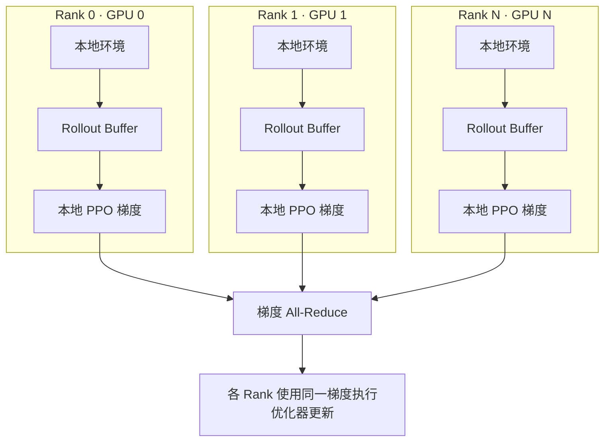
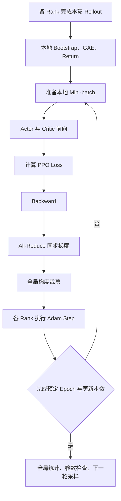

# 分布式强化学习训练架构与并行机制

## 1. 概述（Overview）

> 本文讨论在线强化学习从单 GPU 扩展到多 GPU 时的数据流、时序、梯度与调度机制，以 PPO 为主要示例。服务器安装、容器部署和启动命令见 [多 GPU 强化学习训练环境部署与运维指南](./01_multi-gpu-training-deployment-guide.md)。

### 1. 研究目标与架构定位

单 GPU PPO 通常重复执行以下过程：**使用当前策略采样 → 计算优势 → 多轮优化 → 使用更新后的策略重新采样**。当仿真或视觉推理耗时较大时，仅增加环境数量可能遇到显存、计算或吞吐瓶颈。

分布式训练要解决三类问题：

1. **并行能力**：多张 GPU 如何独立执行环境与策略推理。
2. **优化正确性**：不同 GPU 的样本与梯度如何组成同一个 PPO 更新。
3. **系统效率**：如何减少慢速环境与跨卡通信导致的等待。

本文将**同步数据并行 PPO**作为基础架构，再讨论 DD-PPO 的提前结束采样，以及异步 Actor–Learner 等扩展方案。多 GPU 只能改善资源利用与墙钟时间，不天然保证更高的样本效率或更好的收敛。

## 2. 基础与定义（Foundations）

### 2. 基本概念与并行方式

| 名称 | 职责 |
|---|---|
| Environment | 推进仿真，产生观测、奖励和结束标志 |
| Policy Inference | 根据当前策略计算动作和价值估计 |
| Learner | 根据采样经验计算损失、反向传播并更新参数 |
| Rank | 分布式进程的全局唯一编号 |
| Worker | 执行采样或学习任务的进程，具体职责由架构确定 |
| Rollout Buffer | 存储当前策略版本采集的训练样本 |
| Process Group | 参与集体通信的一组进程 |

常见并行方式：

- **环境并行**：多个环境独立推进，观测和动作按批处理。
- **数据并行**：每个 Rank 拥有网络副本与不同样本，计算本地梯度后同步。
- **模型并行**：将同一网络的不同部分放在不同设备上，主要用于单卡放不下的大模型。
- **Actor–Learner 分离**：采样进程与优化进程承担不同职责，允许各自独立扩展。

对中小规模 PPO 策略网络和高成本 GPU 仿真，优先研究**每 GPU 一个 Rank，每 Rank 同时负责本地环境和 PPO 优化**。

## 3. 核心原理（Core Principles）

### 3. 同步数据并行 PPO 架构

#### 3.1 每个 Rank 持有什么

每个 Rank 通常拥有：

- 一批互相独立的仿真环境。
- Actor、Critic 以及必要特征网络的本地副本。
- 本地 Rollout Buffer 与优势估计结果。
- 相同配置的优化器及优化器状态。
- 本 Rank 的随机数状态、地图分配与环境状态。

架构示意：



Rollout 不必集中拷贝到 Rank 0；大部分网络训练通信发生在参数更新时。

#### 3.2 本地与全局采样量

设第 $r$ 个 Rank 拥有 $N_r$ 个环境，每个环境收集 $T_r$ 个策略步，则：

$$
B_r=N_rT_r,\qquad B_{\mathrm{global}}=\sum_{r=0}^{G-1}B_r
$$

固定长度且均匀划分时：

$$
B_{\mathrm{global}}=GNT
$$

例如 8 GPU、每卡 64 个环境、每环境 256 步，则每卡 16,384 条、全局 131,072 条 Transition。这里的数值用于解释采样量，不代表推荐配置。

**Rollout Batch、PPO Mini-batch 和一次优化器更新使用的有效 Batch 是不同概念**。增加 GPU 数量时，须明确要保持全局 Batch 固定，还是保持每卡 Batch 固定。

### 4. 一轮 PPO 的完整时序

#### 4.1 初始化

1. 建立分布式进程组，明确 Rank 与 GPU 绑定关系。
2. 初始化 Actor、Critic 及优化器。
3. 同步所有可训练参数，并使各 Rank 的优化器状态一致。
4. 为各 Rank 分配独立环境、场景和随机数流。

首次训练可以先同步模型权重，再分别建立相同状态的优化器；从检查点恢复时，优化器状态与调度状态也必须一致。

#### 4.2 独立采样

一轮 Rollout 内，各 Rank 使用相同版本的策略，各自执行：

```text
本地环境状态 → Policy Forward → 动作
        ↓
仿真推进 → 下一观测、Reward、Done
        ↓
保存 Obs、Action、Old LogProb、Value、Reward 与结束标志
        ↓
重复直到满足本轮 Rollout 结束条件
```

**采样期间没有 PPO 梯度需要 All-Reduce**。策略推理通常禁用梯度图，以免跨长时间 Rollout 保存无用的计算图。

#### 4.3 Bootstrap 与 GAE

Rollout 到达固定采样边界时，正在进行中的 Episode 并没有真实终止，需要使用边界状态的 Critic 估计进行 Bootstrap。

GAE 可表示为：

$$
\delta_t=r_t+\gamma m_tV(s_{t+1})-V(s_t)
$$

$$
\hat A_t=\delta_t+\gamma\lambda m_t\hat A_{t+1}
$$

其中 $m_t$ 控制是否继续跨时间传播。**真实终止**和**因采样窗口结束而截断**不能混为一谈。对于时间上限触发的截断，还应依据任务的终止语义决定是否从最终观测 Bootstrap，且不能错误地跨 Episode Reset 连接 GAE。

GAE 与 Return 可以在各 Rank 本地计算，无须集中传输完整序列。

#### 4.4 PPO 更新

每个 Rank 根据本地 Buffer 构造 Mini-batch，重新执行 Actor/Critic 前向传播，计算 PPO Loss 和 Value Loss，然后反向传播。



每次同步 PPO 更新必须保证所有 Rank 的**集体通信调用次数和顺序匹配**。即使某 Rank 的本地数据较少，也不能单独少做一次需要同步的 `backward`。

#### 4.5 更新前后的同步点

| 阶段 | 是否通常需要跨 Rank 通信 |
|---|---|
| 环境单步推进 | 否 |
| Actor 采样推理 | 否 |
| 本地 GAE 与 Return | 否 |
| PPO Backward | 是，同步可训练梯度 |
| 自适应学习率所需的全局 KL | 视实现需要 |
| 全局指标和课程决策 | 是，按统计语义聚合 |
| 下一轮 Rollout 前的参数状态 | 必须逻辑一致，通常已由同步更新保证 |

### 5. 梯度同步与优化正确性

#### 5.1 All-Reduce 的数学含义

第 $r$ 个 Rank 对本地 Loss 求导：

$$
g_r=\nabla_\theta\mathcal L_r
$$

若每卡使用等量样本且各自 Loss 为本地样本均值，可采用：

$$
\bar g=\frac1G\sum_{r=0}^{G-1}g_r
$$

所有 Rank 使用相同的 $\bar g$ 执行 Adam 更新。同步的是**梯度**，而不是在 Rank 0 收齐所有数据后独自 Backward。

如果不同 Rank 的有效 Mini-batch 样本数为 $b_r$，真正按样本等权的梯度应为：

$$
g_{\mathrm{sample}}=\frac{\sum_rb_rg_r}{\sum_rb_r}
$$

因此普通的 Rank 等权梯度平均，在本地样本数量不同或主动进行地图重采样时，可能不再等价于全局样本均值。

#### 5.2 同步实现方式

- **DDP 自动同步**：可训练网络经过分布式包装，通常在 `backward()` 内触发梯度通信。
- **手动同步**：在 `backward()` 后显式对梯度执行 `all_reduce`，再求平均。
- **不要双重同步**：已经使用 DDP 的梯度，不应再无条件额外进行同一次手动 All-Reduce。

NCCL 负责 GPU 间的集体通信。All-Reduce 的实际通信拓扑取决于后端、设备与网络，并不等于梯度必须先传到 Rank 0。

#### 5.3 梯度裁剪与更新顺序

推荐检查以下顺序：

```text
zero_grad → forward → loss → backward
          → gradient all-reduce → gradient clipping → optimizer step
```

若 Actor 和 Critic 使用不同参数集合，应分别计算梯度范数和裁剪；这样 Critic 的大梯度不会通过统一的裁剪系数压小 Actor 梯度。若网络存在共享 Encoder，需要明确定义共享参数的归属与裁剪方式。

**独立优化器也需要一致的更新次数和状态**。只同步模型权重而不恢复 Adam 的动量状态，可能造成恢复后的 Rank 参数分叉。

#### 5.4 Advantage、KL 与统计量

- **本地 Advantage 标准化**：每个 Rank 分别估计均值和方差，会改变不同 Rank 对总更新的相对贡献。
- **全局 Advantage 标准化**：对全部有效样本汇总 `sum`、`sum of squares`、`count` 后计算统一统计量。
- **不标准化**：保留原始优势尺度。DD-PPO 原论文采用此方案，但其结论不应直接推广到其他任务。
- **全局 KL**：如果 KL 决定学习率或训练早停，应按样本权重聚合，避免各 Rank 更新策略不一致。
- **Episode 指标**：成功率应使用全局成功回合数除以全局已完成回合数，而非简单平均各 Rank 的成功率。

### 6. Rollout 调度与负载均衡

#### 6.1 固定长度 Rollout

固定 $T$ 的优点是样本规模、GAE 边界、Mini-batch 数量容易保持一致；缺点是：

$$
T_{\mathrm{rollout}}\approx\max_r T_r^{\mathrm{sample}}
$$

快 Rank 完成后仍需等待最慢 Rank。地图复杂度、物理对象数量、视觉渲染与 CPU 负载都可能造成这种等待。

#### 6.2 DD-PPO 的 Rollout Preemption

DD-PPO 允许在一定比例的 Worker 收满最大 Rollout 后，提前结束仍在采样的慢速 Worker。

- 原文报告 60% 的完成比例阈值通常有效。
- 每个 Worker 至少采集最大采样长度的四分之一。
- 慢速 Worker 已采到的数据仍用于 PPO，不直接丢弃。
- 各 Worker 在采样完成后仍进入同步优化，保持 On-Policy 版本一致性。

该机制改善墙钟吞吐，但可能导致耗时更长的复杂场景贡献更少样本。加入 Preemption 后必须处理不等长 Buffer、Bootstrap、相同数量的同步优化步骤与不同 Rank 的梯度权重。

#### 6.3 VER 与动态采样量

VER 进一步研究在高复杂度环境中让不同采样 Worker 贡献可变数量的经验。它的目标是降低同步等待、提高采样利用率，而不是修改 PPO 的主要损失形式。

实际选型应遵循：**先测量同步等待；只有等待成为主要瓶颈，再引入可变 Rollout 或更复杂的调度。**

## 4. 实现与应用（Implementation & Applications）

### 9. 参考实例：8 GPU 轨迹决策 PPO

以下是一个具体系统的实现案例，用来检查前述通用机制，而不是规定所有 PPO 项目必须使用的配置。

```text
Rank 0 广播模型参数；各 Rank 建立一致的优化器状态
       ↓
8 个 Rank 独立运行本地地图和 UAV
       ↓
每个策略步：轨迹选择 → 25 次物理子步 → 新观测与奖励
       ↓
各 Rank 收满 256 步固定 Rollout
       ↓
本地 Critic Bootstrap → GAE → Advantage 标准化
       ↓
按地图均衡形成 Mini-batch
       ↓
3 个 PPO Epoch：Backward → 8 卡 All-Reduce
       ↓
Actor/Critic 分别裁剪 → 各 Rank Adam Step
       ↓
全局指标、参数一致性检查、Curriculum 刷新
       ↓
Rank 0 保存公共日志与 Checkpoint
```

与 DD-PPO 相比，该实例已经具有**去中心化同步梯度更新**，但采用**固定长度 Rollout**，没有启用 Preemption。此外，还加入地图均衡 Mini-batch、独立梯度裁剪和分布式 Curriculum 管理。

这套架构优先需要验证：各 Rank 的采样时间差异、全局地图权重、本地 Advantage 标准化的影响，以及 Curriculum 是否在共同的轮次边界完成同步。

## 5. 分析与总结（Analysis & Summary）

### 7. 异步架构与多节点扩展

| 架构 | 主要特点 | 主要风险 |
|---|---|---|
| 同步数据并行 PPO | 每 Rank 采样、计算梯度、共同更新 | 慢 Rank 等待 |
| DD-PPO | 同步 PPO 加采样提前结束 | 地图样本权重变化 |
| 异步 Actor–Learner | 采样与优化流水线分离 | Policy Lag、旧策略数据 |
| 多节点同步 PPO | 多台服务器组成统一进程组 | 网络带宽、故障传播、通信等待 |

异步采样需要记录每条经验对应的策略版本，并处理采样分布与当前策略不一致的问题；不能只把旧 Rollout 直接当成严格 On-Policy 数据。

多节点 DDP 只是将 Rank 扩展到多台主机，但网络通信、进程发现、GPU/CPU 资源、场景存储及故障恢复都必须重新评估。本文不将多节点执行视为当前单机架构的自动能力。

### 8. 性能测量与正确性验证

#### 8.1 性能拆分

一次训练迭代的主要耗时可近似分解为：

$$
T_{\mathrm{iter}}=T_{\mathrm{rollout}}+T_{\mathrm{update}}+T_{\mathrm{sync}}+T_{\mathrm{misc}}
$$

其中同步梯度通信可能与 Backward 部分重叠；实际计时应说明是否重复计算重叠时间。

重点记录：

| 指标 | 用途 |
|---|---|
| 全局环境步每秒 | 衡量总样本吞吐 |
| 每 Rank Rollout 耗时 | 判断负载差异 |
| PPO 更新耗时 | 判断 Learner 瓶颈 |
| 梯度通信耗时 | 判断 All-Reduce 开销 |
| 同步等待耗时 | 判断 Straggler Effect |
| GPU 利用率与显存 | 判断资源利用效率 |
| 同步后 Actor/Critic 梯度范数 | 判断优化一致性与裁剪效果 |

#### 8.2 扩展性实验

- **Strong Scaling**：固定全局任务规模，增加 GPU 数量，比较完成时间。
- **Weak Scaling**：固定每卡环境规模，增加 GPU 数量，比较总吞吐及每卡效率。

加速比与并行效率定义为：

$$
S(G)=\frac{T(1)}{T(G)},\qquad E(G)=\frac{S(G)}{G}
$$

比较收敛质量时应同时控制或记录**总环境交互步数、全局 Batch、PPO Epoch 和优化器更新次数**，否则训练速度和学习效率容易混淆。

#### 8.3 最小正确性检查

1. 所有 Rank 在初始化及每轮更新后具有一致的可训练参数。
2. 各 Rank 的 Adam 状态和学习率调度状态一致。
3. 每轮进行同样次数、同样顺序的集体通信。
4. 同步梯度与独立构造的全局 Batch 参考结果在数值容差内一致。
5. Rollout 边界、Episode 终止及时间截断的 Bootstrap 正确。
6. 全局统计结果按有效样本数或回合数加权，而不是任意平均。

### 10. 总结与参考文献

同步分布式 PPO 的基本原则是：**采样可独立，训练参数必须同步；局部数据可以不同，全局优化语义必须明确。**

在系统规模不大时，应优先保持固定 Rollout 和明确的同步时序。只有在实际测量证实慢 Worker 或通信瓶颈后，再考虑 Preemption、可变 Rollout 或 Actor–Learner 分离架构。

## 6. 关联与参考（Related Topics & References）

推荐阅读：

- [DD-PPO：Learning Near-Perfect PointGoal Navigators from 2.5 Billion Frames](https://arxiv.org/abs/1911.00357)
- [VER：Scaling On-Policy RL Leads to the Emergence of Navigation in Embodied Rearrangement](https://arxiv.org/abs/2210.05064)
- [Sample Factory](https://github.com/alex-petrenko/sample-factory)
- [RSL-RL](https://github.com/leggedrobotics/rsl_rl)
- [skrl](https://github.com/Toni-SM/skrl)
- [PyTorch DistributedDataParallel](https://pytorch.org/docs/stable/generated/torch.nn.parallel.DistributedDataParallel.html)
- [多 GPU 强化学习训练环境部署与运维指南](./01_multi-gpu-training-deployment-guide.md)